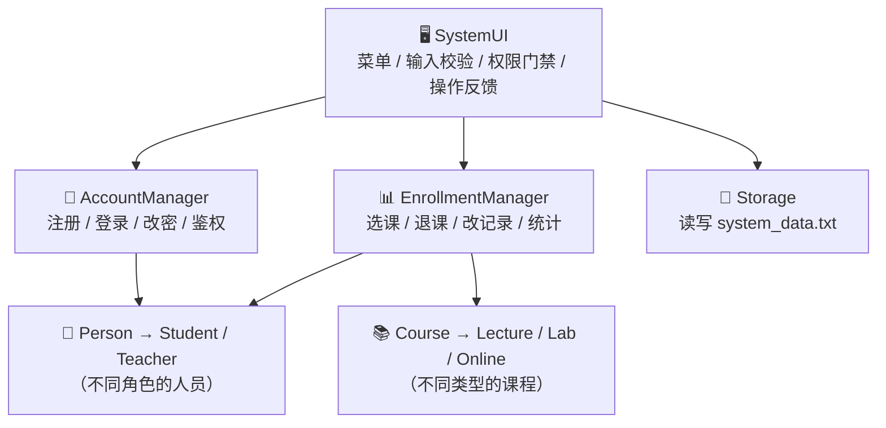

<a id="top"></a>
<div align="center">

# 🎓 课程报名管理系统

### *Course Registration System — C++ 控制台交互版*

**一个以「封装 · 继承 · 多态」为核心设计思想实现的**
**账户体系 + 报名增删改查 + 文件持久化 的完整小型管理系统**


<br/>

🚀 *零依赖 · 单文件 · 打开即编译* &nbsp;|&nbsp; 💾 *数据实时落盘，重启不丢失* &nbsp;|&nbsp; 🔐 *登录鉴权，未登录禁止报名*

</div>

---

## 📑 目录

**[📌 项目简介](#intro)** ·
**[✨ 核心功能](#features)** ·
**[🖥️ 运行效果](#demo)** ·
**[🏗️ 系统设计](#design)** ·
**[📂 项目结构](#structure)** ·
**[🚀 快速开始](#start)** ·
**[🎮 使用指南](#guide)** ·
**[💾 数据持久化](#data)** ·
**[🧪 测试清单](#test)** ·
**[❓ 常见问题](#faq)** ·
**[📜 许可证](#license)**

---

<a id="intro"></a>
## 📌 项目简介

> 💡 **这是什么？**
> 一个纯 C++17 实现的**交互式课程报名管理系统**——不是静态演示，而是可注册、可登录、
> 可增删改查、可断电重开的**功能闭环**程序。控制台即界面，菜单即按钮，输入即表单，
> 每一次操作都会得到明确反馈并**立即写入磁盘**。

| 特性 | 说明 |
| :--: | --- |
| 🎯 **面向对象** | 两条继承层次 + 六处运行期多态，是 OOP 课程设计的完整参考实现 |
| 🔐 **账户体系** | 注册 / 登录 / 注销 / 改密，未登录无法报名，学生与管理员分权 |
| 🛠️ **报名管理** | 人员**增删改查**、报名记录换课 / 退课 / 恢复、多条件组合查询 |
| 💾 **真实持久化** | 每次变更即时写 `system_data.txt`，重启 / 重登数据完整恢复 |
| 🛡️ **输入校验** | 20+ 类边界与错误场景均有中文提示，绝不静默失败 |
| 📦 **零依赖** | 单个 `main.cpp`，仅用标准库，VS 双击即可编译运行 |

<div align="right"><a href="#top">⬆️ 返回顶部</a></div>

---

<a id="features"></a>
## ✨ 核心功能

### 1️⃣ 账户系统

| 功能 | 菜单 | 说明 |
| :--: | :--: | --- |
| 🆕 用户注册 | `3` | 新学号自动建档；已有人员一键**绑定账户**；用户名唯一性校验 |
| 🔑 用户登录 | `4` | 口令哈希校验，区分“用户名不存在 / 密码错误” |
| 🚪 注销登录 | `l` | 注销后立即恢复访客态，报名类操作被禁止 |
| 🔒 修改密码 | `m` | 需验证旧密码 + 两次输入一致，改完即时落盘 |

### 2️⃣ 报名管理（管理员）

| 功能 | 菜单 | 说明 |
| :--: | :--: | --- |
| ➕ 添加报名人员 | `a` | 姓名 / 专业 / 绩点 / 联系电话，学号唯一 |
| 🔍 按条件查询 | `b` | **7 种条件**：全部 / 学号 / 姓名模糊 / 课程编号 / 课程名称 / 状态 / 课程类型 |
| ✏️ 修改报名记录 | `c` | 换课（重新校验容量与绩点）、置退课、恢复有效 |
| ✏️ 修改人员信息 | `d` | 姓名 / 专业 / 绩点 / 电话，姓名同步到登录账户 |
| 🗑️ 删除报名人员 | `e` | 二次确认 + **级联清理**报名记录与关联账户 |
| 📊 统计报表 | `f` | 按课程 / 类型 / 人员多维统计，自动标记满员课程 |
| 📜 全部流水 | `g` | 含已退课记录的完整审计流水 |

### 3️⃣ 学生报名（需登录）

| 功能 | 菜单 | 说明 |
| :--: | :--: | --- |
| 📚 课程报名 | `5` | 依次校验：人员存在 → 课程存在 → **重复选课** → **容量已满** → **选课资格** |
| ❌ 退课 | `6` | 保留历史记录，释放名额，允许后续重选 |
| 📋 我的报名 | `7` | 实时清单 + 学分合计 |
| 👤 个人信息 | `8` | 档案与账户信息 |

<div align="right"><a href="#top">⬆️ 返回顶部</a></div>

---

<a id="demo"></a>
## 🖥️ 运行效果

### 界面总览

```text
================================================================
                  课程报名管理系统  v2.0
----------------------------------------------------------------
 当前状态：已登录  赵六（学生, 学号 20240104）  账户：zhaoliu
----------------------------------------------------------------
  【基础】  1. 浏览课程目录与师资     2. 查询课程详情
            3. 用户注册                4. 用户登录
  【报名】* 需学生账户登录后使用
            5. 课程报名（选课）        6. 退课
            7. 查询我的报名信息        8. 查看我的个人信息
  【管理】* 仅管理员可用
            a. 添加报名人员            b. 按条件查询报名信息
            c. 修改报名记录            d. 修改人员信息
            e. 删除报名人员            f. 报名统计报表
            g. 查看全部报名流水
  【账户】  m. 修改登录密码            l. 注销登录
            0. 退出系统（自动保存数据）
================================================================
 请选择操作 >
```

### 🛡️ 边界情况的真实反馈

```text
[提示] 尚未登录，无法进行「课程报名」，请先使用菜单 4 登录！
[失败] 课程报名失败：重复选课，该课程已选修
[失败] 课程报名失败：课程容量已满
[失败] 课程报名失败：不满足该课程的选课条件
[失败] 登录失败：密码错误，请检查后重试。
[权限不足] 「添加报名人员」仅管理员可用。
[输入错误] 两次输入的密码不一致，请重新设置。
[成功] 报名人员已删除（级联清理报名记录 0 条）！
[已保存] 数据已写入 system_data.txt
```

### 📊 统计报表片段

```text
[1] 各课程报名人数：
    L201 程序设计基础实验 (实验课) : 已报 2 / 2 人, 剩余 0 个名额, 占用率 100.0%  [满员]
    C101 高等数学 (理论课(讲授)) : 已报 1 / 60 人, 剩余 59 个名额, 占用率 1.7%
[4] 报名记录汇总：有效 7 条, 已退课 1 条, 历史合计 8 条。
```

<details>
<summary>🔁 <b>重启后的持久化效果</b>（点击展开）</summary>

```text
[数据] 已从 system_data.txt 加载：账户 4 个，报名人员 4 人，报名记录 4 条。
[成功] 登录成功，欢迎 赵六！角色：学生
  20240104 赵六（信息安全, 绩点 3.50）报名清单：
    #1 - L202 数据库系统实验 (实验课) 2 学分 | 学费 480.0 元 | 2026-10-06
    #2 - L201 程序设计基础实验 (实验课) 2 学分 | 学费 500.0 元 | 2026-10-06
    合计：2 门 / 4 学分
```

</details>

<div align="right"><a href="#top">⬆️ 返回顶部</a></div>

---

<a id="design"></a>
## 🏗️ 系统设计

### 🧬 架构分层



### 🎭 面向对象三大特性落点

| 特性 | 实现位置 |
| :--: | --- |
| **🔒 封装** | 数据成员全部 `private`，仅暴露 `getter/setter`；校验内置在接口内（绩点 0–5、容量为正、用户名唯一、口令哈希存储） |
| **🪜 继承** | `Person → Student / Teacher`（角色层次）；`Course → LectureCourse / LabCourse / OnlineCourse`（课程类型层次）；基类析构均为 `virtual` |
| **🎭 多态** | `displayInfo()` / `getTypeName()` / `computeTuition()` / `checkEnrollment()` / `requirementDesc()` / `displayDetail()` —— 6 处虚函数经基类指针运行期分派 |

<details>
<summary>🧪 <b>多态策略差异一览</b>（点击展开）</summary>

| 课程类型 | 学费计算（`computeTuition`） | 选课资格（`checkEnrollment`） |
| --- | --- | --- |
| 📖 理论课 `LectureCourse` | 学分 × 单价 | 绩点 ≥ 1.5 |
| 🔬 实验课 `LabCourse` | 学分 × 单价 + 材料费 | 绩点 ≥ 2.5 / 3.0（按课程配置） |
| 🌐 在线课 `OnlineCourse` | 学分 × 单价 × 0.6 + 平台费 | 无附加门槛 |

</details>

<div align="right"><a href="#top">⬆️ 返回顶部</a></div>

---

<a id="structure"></a>
## 📂 项目结构

```text
course-registration-system/
├── 📄 main.cpp              # 全部源码（约 1900 行，UTF-8 with BOM，含详细中文注释）
├── 📄 README.md             # 项目说明（本文件）
├── 📄 LICENSE               # MIT 许可证
├── 📄 .gitignore            # 忽略构建产物与运行期数据
├── 📄 .gitattributes        # 统一换行符规则
└── 📄 system_data.txt       # ▸ 运行后自动生成（已 gitignore，删除即重置数据）
```

> **文件说明**
> - `main.cpp` 采用 **UTF-8 with BOM** 编码，VS2022 无需任何额外设置即可正确编译中文；
>   ⚠️ 请勿用编辑器“另存为”时去掉 BOM，否则 MSVC 可能报中文字符串编码错误。

<div align="right"><a href="#top">⬆️ 返回顶部</a></div>

---

<a id="start"></a>
## 🚀 快速开始

### 🧰 环境要求

| 环境 | 要求 |
| --- | --- |
| 💻 Windows | Visual Studio 2022（含“使用 C++ 的桌面开发”工作负载） |
| 🍎 macOS / 🐧 Linux | `g++` ≥ 9 或 `clang++` ≥ 10（`gcc --version` 自查） |
| 📌 语言标准 | **C++17**，仅使用标准库，无任何第三方依赖 |

### 🅰️ 方式一：Visual Studio 2022（Windows，推荐）

```text
1. 打开 VS2022 → 创建新项目 → 选择「控制台应用(C++)」→ 创建
2. 删除模板自带的 xxx.cpp
3. 右键项目 → 「添加」→「现有项」→ 选择本项目中的 main.cpp
4. 按 Ctrl+F5（开始执行，不调试）即可运行
```

### 🅱️ 方式二：命令行 MSVC（Windows）

在开始菜单搜索并打开 **x64 Native Tools Command Prompt for VS 2022**，执行：

```bat
cd /d "你的项目路径\course-registration-system"
cl /nologo /std:c++17 /EHsc /W3 /Fe:CourseRegistration.exe main.cpp
CourseRegistration.exe
```

### 🅲️ 方式三：g++ / clang++（macOS / Linux / Windows-MinGW）

```bash
cd 你的项目路径/course-registration-system

# Linux / macOS
g++ -std=c++17 -Wall -Wextra -O2 main.cpp -o registration && ./registration

# macOS（Apple Clang）
clang++ -std=c++17 -Wall -Wextra -O2 main.cpp -o registration && ./registration
```

> ✅ 代码不含任何平台专用 API（`localtime_s` 已用 `#ifdef _MSC_VER` 隔离），
> Windows / macOS / Linux 三端均可直接编译。

### ⬇️ 从 GitHub 克隆

```bash
git clone https://github.com/<你的用户名>/course-registration-system.git
cd course-registration-system
```

<div align="right"><a href="#top">⬆️ 返回顶部</a></div>

---

<a id="guide"></a>
## 🎮 使用指南

### 🔐 默认账户（首次运行自动初始化）

| 角色 | 用户名 | 密码 | 备注 |
| :--: | :--: | :--: | --- |
| 👑 管理员 | `admin` | `admin123` | 拥有 a–g 全部管理权限 |
| 🧑‍🎓 示例人员 | — | — | `20240101` 张三 / `20240102` 李四 / `20240103` 王五（**尚无账户**） |

### 🔁 推荐上手动线（功能闭环）

```text
① 4 登录 admin/admin123 ──▶ ② a 添加报名人员 ──▶ ③ l 注销
        │
        ▼
④ 3 用该学号注册绑定账户 ──▶ ⑤ 4 登录学生账户 ──▶ ⑥ 5 选课 / 6 退课 / 7-8 查询
        │
        ▼
⑦ 重新登录 admin ──▶ b/c/d/e/f/g 查询·修改·删除·统计 ──▶ 0 退出（自动保存）
        │
        ▼
⑧ 重新打开程序：数据完好，原账户可正常登录 ✅
```

### 🧭 菜单一览

| 分组 | 菜单项 | 权限 |
| --- | --- | :--: |
| 🏁 **基础** | `1` 课程目录与师资 · `2` 课程详情 · `3` 注册 · `4` 登录 | 公共 |
| 📚 **报名** | `5` 选课 · `6` 退课 · `7` 我的报名 · `8` 我的信息 | 学生 |
| 🛠️ **管理** | `a` 添加 · `b` 查询 · `c` 改记录 · `d` 改信息 · `e` 删除 · `f` 统计 · `g` 流水 | 管理员 |
| 👤 **账户** | `m` 改密码 · `l` 注销 · `0` 退出（自动保存） | 按需 |

<div align="right"><a href="#top">⬆️ 返回顶部</a></div>

---

<a id="data"></a>
## 💾 数据持久化

所有写操作都会**立即**落盘到程序当前工作目录下的 `system_data.txt`
（临时文件 + 原子替换，防止写坏）：

```text
# 课程报名管理系统数据文件（自动生成，请勿手工编辑）
[USERS]
admin|系统管理员||admin|e4fc7d3c3a2b350f
zhaoliu|赵六|20240104|student|ba48d9af1f905de5

[STUDENTS]
20240101|张三|计算机科学与技术|3.80|13800000001

[RECORDS]
1|20240104|L202|2026-10-06|1
2|20240104|L201|2026-10-06|0
```

| 说明项 | 内容 |
| --- | --- |
| 📍 生成位置 | VS 调试时为**项目目录**；双击 exe 时为 **exe 所在目录** |
| 🔐 口令存储 | `FNV-1a` 哈希（**不存明文**，教学演示用途，生产环境请换 bcrypt/scrypt） |
| ♻️ 重置数据 | 直接**删除** `system_data.txt`，下次运行恢复出厂状态 |
| 🚫 隐私保护 | 该文件已在 `.gitignore` 中，**不会被上传到 GitHub** |

<div align="right"><a href="#top">⬆️ 返回顶部</a></div>

---

<a id="test"></a>
## 🧪 测试清单

> ✅ 已在 **Windows + MSVC 2022 (`/std:c++17 /EHsc /W4`)** 下编译，**零警告零错误**，
> 并通过自动化脚本完成两轮全流程回归（含重启持久化验证）。

<details>
<summary>🧪 <b>点击展开完整边界测试清单</b></summary>

| # | 场景 | 期望反馈 |
| :-: | --- | --- |
| 1 | 未登录执行选课 / 管理 | `[提示] 尚未登录，无法进行「…」` |
| 2 | 学生访问管理菜单 | `[权限不足] 该功能仅管理员可用` |
| 3 | 管理员执行选课 | `[提示] 管理员账户不参与报名` |
| 4 | 重复选课 | `失败：重复选课，该课程已选修` |
| 5 | 课程容量已满（L201 仅 2 人） | `失败：课程容量已满` |
| 6 | 绩点不足（2.2 报 3.0 实验课） | `失败：不满足该课程的选课条件` |
| 7 | 课程 / 学号 / 流水号不存在 | 各自对应的“不存在”提示 |
| 8 | 退未选修的课程 | `失败：尚未选修该课程` |
| 9 | 用户名已占用 / 学号已绑定 | 独立报错并允许重新输入 |
| 10 | 两次密码不一致 | `[输入错误]` 并循环重填 |
| 11 | 空输入 / 无效菜单（`9`、`12`） | `[错误] 无效的菜单选项` |
| 12 | 删除人员 | `y/n` 二次确认 + 级联清理 + 列表刷新 |
| 13 | 修改密码后重登 | 旧密码失效、新密码可登录 |
| 14 | 重启程序 | 账户 / 人员 / 记录 / 学分全部恢复 |
| 15 | 输入流意外结束 | 自动保存数据后安全退出 |

</details>

<div align="right"><a href="#top">⬆️ 返回顶部</a></div>

---

<a id="faq"></a>
## ❓ 常见问题

<details>
<summary><b>❓ Q1：运行时提示中文乱码怎么办？</b></summary>

<br/>

- 请确认 `main.cpp` 仍是 **UTF-8 with BOM**（记事本/VS Code 另存为时选择“UTF-8 with BOM”）；
- Windows 控制台使用系统默认 GBK 代码页时，MSVC 会自动把源码中的中文转为 GBK 输出，正常显示；
- macOS / Linux 终端默认 UTF-8，直接编译即可。

</details>

<details>
<summary><b>❓ Q2：数据文件在哪里？如何彻底重置？</b></summary>

<br/>

`system_data.txt` 生成在**程序运行时的当前目录**（VS 调试 = 项目目录，双击 exe = exe 目录）。
删除该文件即可恢复“管理员 + 3 名示例人员”的出厂状态。

</details>

<details>
<summary><b>❓ Q3：能自己加课程或改容量吗？</b></summary>

<br/>

课程是代码中的静态数据（`main.cpp` 的 `main()` 函数里），修改课程编号 / 名称 / 容量 /
教师后重新编译即可；课程容量也可以通过 `Course::setCapacity()` 在运行期修改。

</details>

<details>
<summary><b>❓ Q4：忘记管理员密码？</b></summary>

<br/>

教学演示环境下，删除 `system_data.txt` 重置即可（会同时清空报名数据）；
或删除文件中 `[USERS]` 节的内容，重启后程序会自动重建默认管理员。

</details>

<div align="right"><a href="#top">⬆️ 返回顶部</a></div>

---

<a id="license"></a>
## 📜 许可证

本项目基于 **MIT License** 开源，详见 [`LICENSE`](./LICENSE)。

```text
MIT © 2026 Prima
```

---

<div align="center">

**⭐ 如果这个项目对你有帮助，欢迎点个 Star 支持一下！**

📖 [报告问题](https://github.com/<用户名>/<仓库名>/issues) ·
🤝 [提交贡献](https://github.com/<用户名>/<仓库名>/pulls) ·
📥 [下载项目](https://github.com/<用户名>/<仓库名>)

<sub>用 C++17 · Visual Studio 2022 构建 —— 封装 · 继承 · 多态，一个都不少。</sub>

</div>
